# Claude code 使用介绍

参考：[Claude Code 最佳实践完整指南](https://xiangyugongzuoliu.com/claude-code-best-practices/)

参考：【Claude Code 零基础终极教程：安装、换模型、插件、Hooks、Skills、Subagents、实战项目一次讲透！】 https://www.bilibili.com/video/BV1TTR8BaEnL/?share_source=copy_web&vd_source=1ed35ac701571426039b619565514e2d

## 一、安装

## 二、Tools

### 2.1、介绍

如下所示的用户需要改变字体颜色需求时，大模型需要判断调用什么工具，如“write_file”这个工具来写入用户要求的语句。一般都内置了在Claude code内，参考官网：[工具参考 - Claude Code Docs](https://code.claude.com/docs/zh-CN/tools-reference)

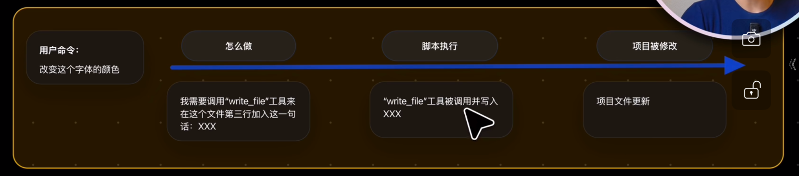

## 三、hooks

### 3.1、介绍

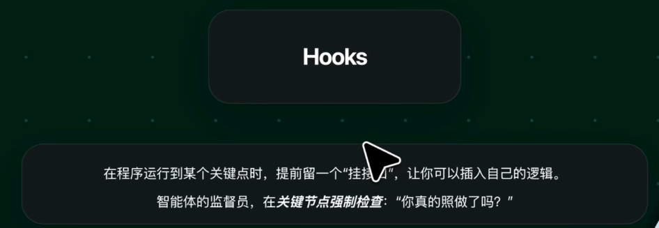

官网介绍：[Hooks 参考 - Claude Code Docs](https://code.claude.com/docs/zh-CN/hooks)

参考示例：
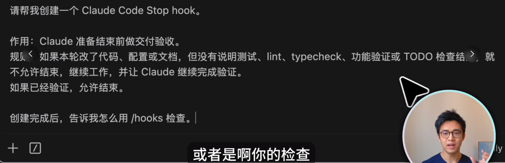

**同样是让Claude自己创建，然后写下需求建立hooks。**

## 四、skills

本质是md文件。

获取/使用方法:
官方skills:[anthropics/skills: Public repository for Agent Skills](https://github.com/anthropics/skills)

other:[The Agent Skills Directory](https://www.skills.sh/?utm_source=sofindai.com)

不会或者不理解就用deepseek把网页复制给他，让他来介绍和总结页面是啥意思。
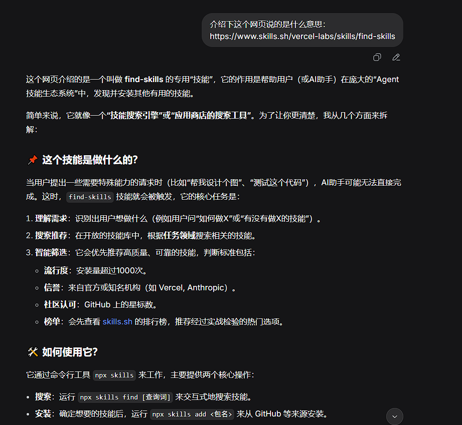

## 五、plugins

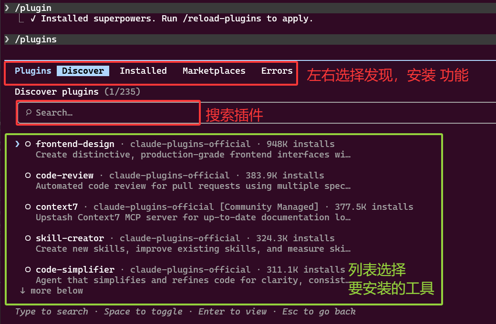
**我已经安装了superpowers插件了，装的全局。安装的时候可以选择安装适用性：所有用户，当前项目等。**


**接下来的是实操项目：**

```sh
需求是这样的：
我要做一个真实可用的 AI 文案网页 App，叫 AI Hook Lab。

功能：用户输入一个主题，选择平台和内容类型，AI一次生成 10 个不同风格的爆款开头 hook。每个结果包含：hook 文案、风格标签、点击欲评分、推荐理由。
技术要求：
• Next.js + TypeScript + Tailwind CSS
• 用 API route 调用大模型
• API key 放在 .env.local，不能暴露到前端
• 不做登录，不做数据库
• 历史记录保存到 localStorage
• 可以部署到 Vercel

页面功能：
1. 输入主题
2. 选择平台：小红书、抖音、B站、YouTube、X
3. 选择内容类型：视频、图文、产品广告、教程、观点帖
4. 生成 10 个 hook
5. 支持复制、收藏、查看历史
6. 没有 API key 时显示清楚错误提示
7. UI 要现代、高级、桌面和手机都好看

请先使用 Superpowers 的 brainstorming 流程，只做产品和技术方案梳理，不要写代码，不要创建文案
```


## 六、SubAgent

创建流程：

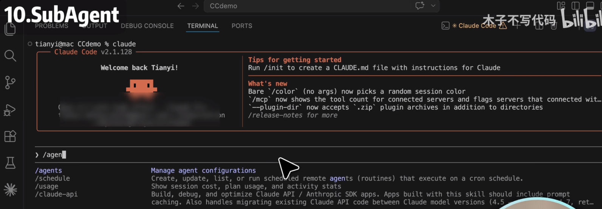


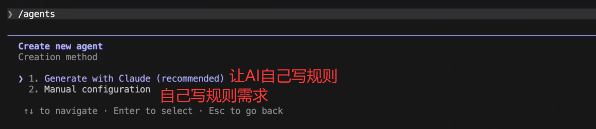


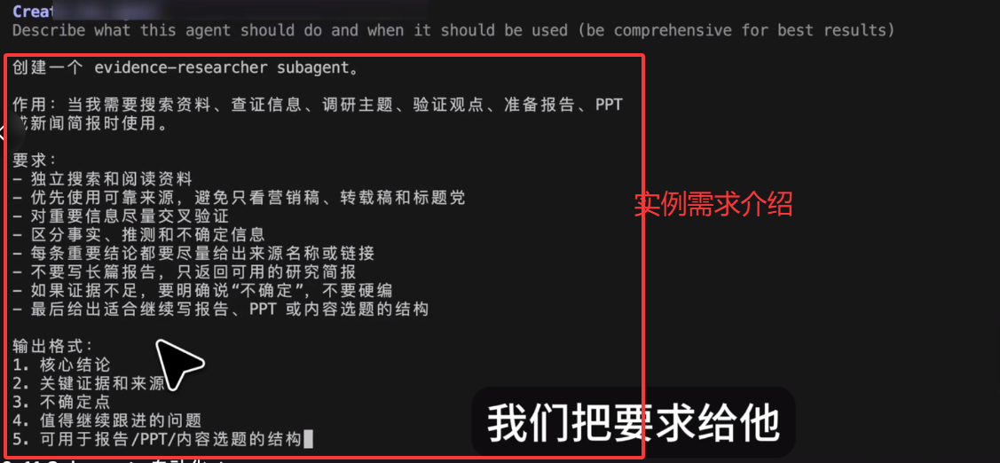


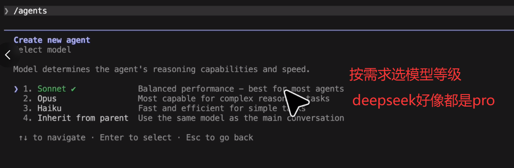


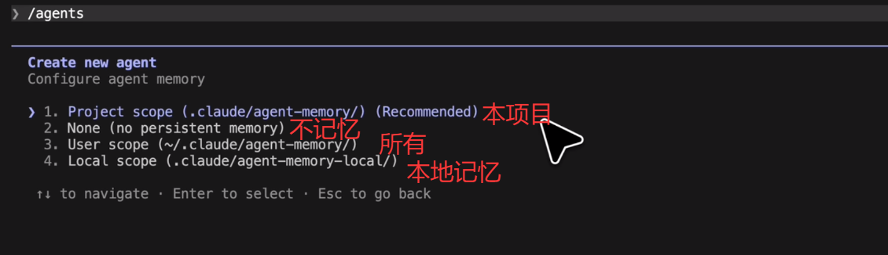

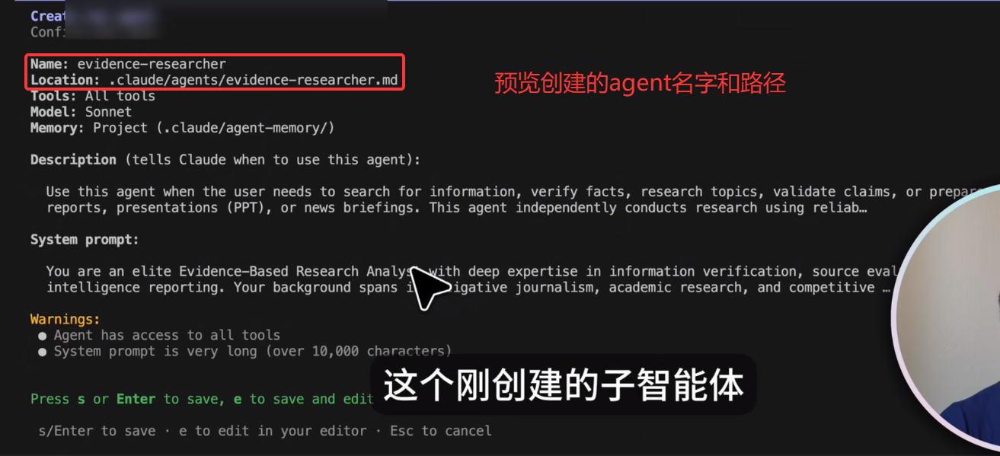


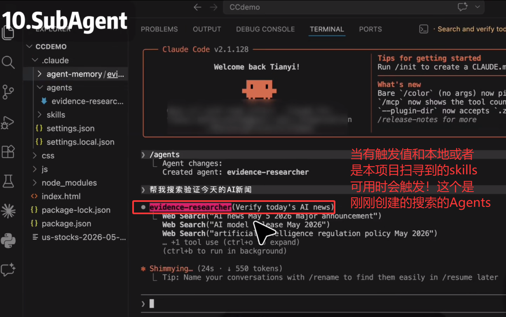
