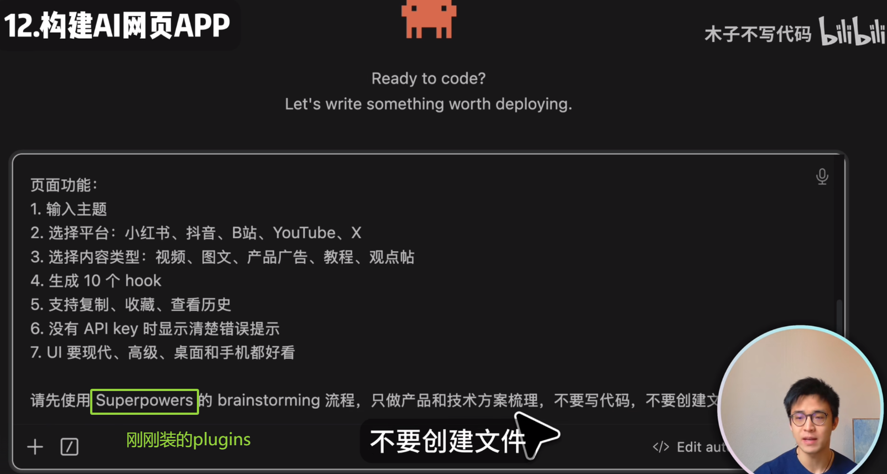
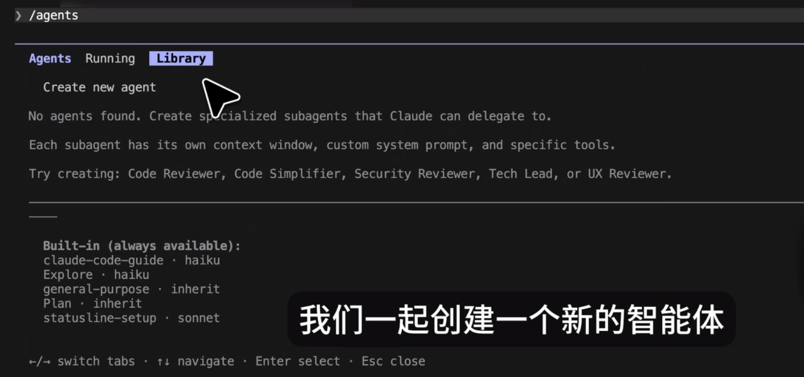
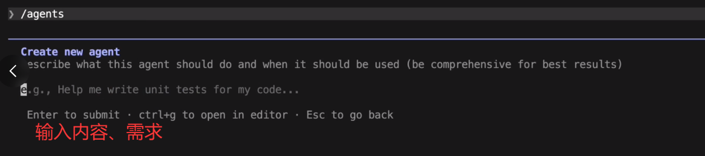
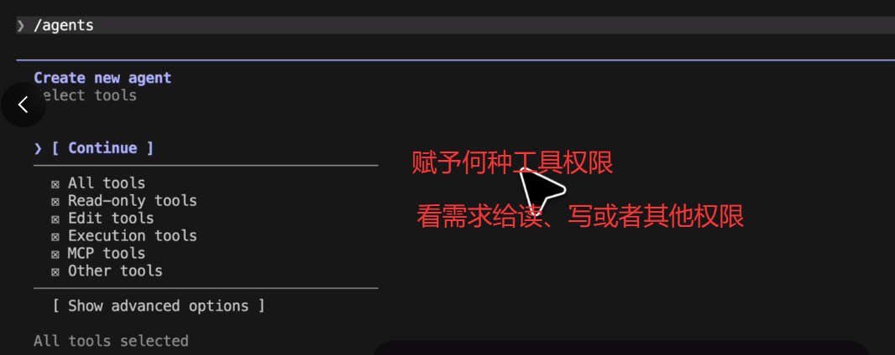
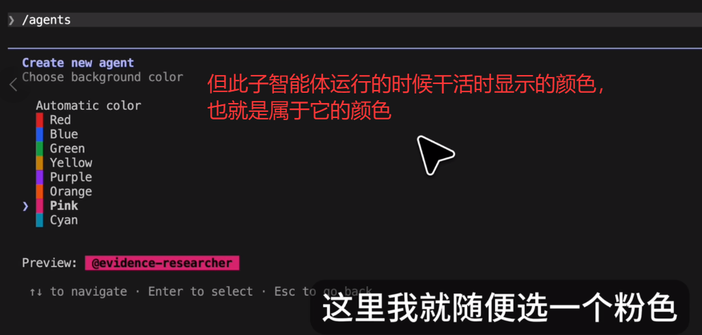
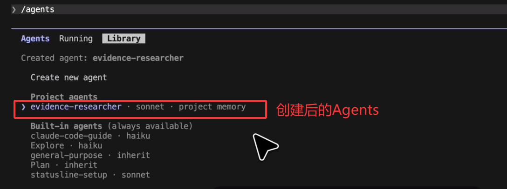
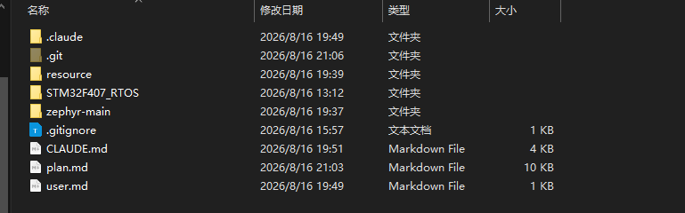

# Claude code 使用介绍

参考：[Claude Code 最佳实践完整指南](https://xiangyugongzuoliu.com/claude-code-best-practices/)

参考：【Claude Code 零基础终极教程：安装、换模型、插件、Hooks、Skills、Subagents、实战项目一次讲透！】 https://www.bilibili.com/video/BV1TTR8BaEnL/?share_source=copy_web&vd_source=1ed35ac701571426039b619565514e2d

## 一、安装

## 二、Tools

### 2.1、介绍

如下所示的用户需要改变字体颜色需求时，大模型需要判断调用什么工具，如“write_file”这个工具来写入用户要求的语句。一般都内置了在Claude code内，参考官网：[工具参考 - Claude Code Docs](https://code.claude.com/docs/zh-CN/tools-reference)


## 三、hooks

### 3.1、介绍


官网介绍：[Hooks 参考 - Claude Code Docs](https://code.claude.com/docs/zh-CN/hooks)

参考示例：


**同样是让Claude自己创建，然后写下需求建立hooks。**

## 四、skills

### 4.1 概述

本质是md文件。

获取/使用方法:
官方skills:[anthropics/skills: Public repository for Agent Skills](https://github.com/anthropics/skills)

other:[The Agent Skills Directory](https://www.skills.sh/?utm_source=sofindai.com)

不会或者不理解就用deepseek把网页复制给他，让他来介绍和总结页面是啥意思。


### 4.2 skills推荐

Document-skills: (word, excel, powerpoint, pdf).

frontend design:(界面ui)

UI-UX-PRO-MAX: ui设计库

find-skills : 找skills的

superpower：AI编程，头脑风暴，设计方案，制定计划，编写代码，验证测试

PUA: 压力AI。


## 五、plugins


**我已经安装了superpowers插件了，装的全局。安装的时候可以选择安装适用性：所有用户，当前项目等。**


**接下来的是实操项目：**

```sh
需求是这样的：
我要做一个真实可用的 AI 文案网页 App，叫 AI Hook Lab。

功能：用户输入一个主题，选择平台和内容类型，AI一次生成 10 个不同风格的爆款开头 hook。每个结果包含：hook 文案、风格标签、点击欲评分、推荐理由。
技术要求：
• Next.js + TypeScript + Tailwind CSS
• 用 API route 调用大模型
• API key 放在 .env.local，不能暴露到前端
• 不做登录，不做数据库
• 历史记录保存到 localStorage
• 可以部署到 Vercel

页面功能：
1. 输入主题
2. 选择平台：小红书、抖音、B站、YouTube、X
3. 选择内容类型：视频、图文、产品广告、教程、观点帖
4. 生成 10 个 hook
5. 支持复制、收藏、查看历史
6. 没有 API key 时显示清楚错误提示
7. UI 要现代、高级、桌面和手机都好看

请先使用 Superpowers 的 brainstorming 流程，只做产品和技术方案梳理，不要写代码，不要创建文案
```


## 六、SubAgent

创建流程：

















## 七、使用技巧

### 7.1、plan+agent

```ai
 在运行/init之前，我希望你先安装以下skills：
  1.Document-skills.
  2.find-skills
  3.skill-creatos.
  4.superpowers.
  然后添加属于本项目中的约定，此约定文件为user.md存放到本项目中与/init后的Claude.md文件同级，要求每次分析编写需求或者代
  码都需要先提前读下此文件。此文件只在我需要添加规则的时候再修改。预先的规则如下：
  1.每次都需要使用中文回复，
  2.在每次要做事情前先自己思考方案，不能直接猛干下去，要一个一个模块的先确认后再执行下去
  3. 遇到代码中有些注释乱码的不需要理会，每次写的代码需要带上英文注释。
  4.只允许在本项目中删除文件时需要申请权限才能做，删除前需要遍历任何与本项目中相关的文件或者函数是否会有冲突后思考是否
  更改。
  暂时如上的规则。
```

之后可以按照所需要求对ai提问，先写plan模式，确认后再动手。目前较为成功的是移植lwip中，我直接提供zephyr的源码交它移植dm9051的示例再结合从csdn拿到一个类似官方的示例伪代码。先写计划让ai先学习之后告诉它环境，之后就是它的solo了，我作为review和测试人员提供信息。同意还是很感谢豆包将pdf转译成md格式输出给ai阅读，但我还不知道加上document-skills的Claude能否直接阅读学习。
感兴趣移植dm9051可以看lwip文件资源，特别注意就是要按照zephyr的dm9051来做，然后在发送和接收的时候提前把中断关了，否则会遇到发送的时候突然来一次中断或者外部脚抖动出现中断情况导致在发送一帧数据时被中断“读取了一次dm9051中断寄存器”就会导致dm9051无任何反应，一般ping 2小时稳定基本没啥问题了。担心的可以ping 一晚上测试。

基本上配置规则后出现如下所示：



user.md是我自己的规则如中午回复，代码注释用英文，不允许删除文件。
plan.md是计划，每次提出的需求实现的记录和讨论的执行版本。
Claude.md则是每次启动后开始读取的记忆和关联了user.md，plan.md的索引。
