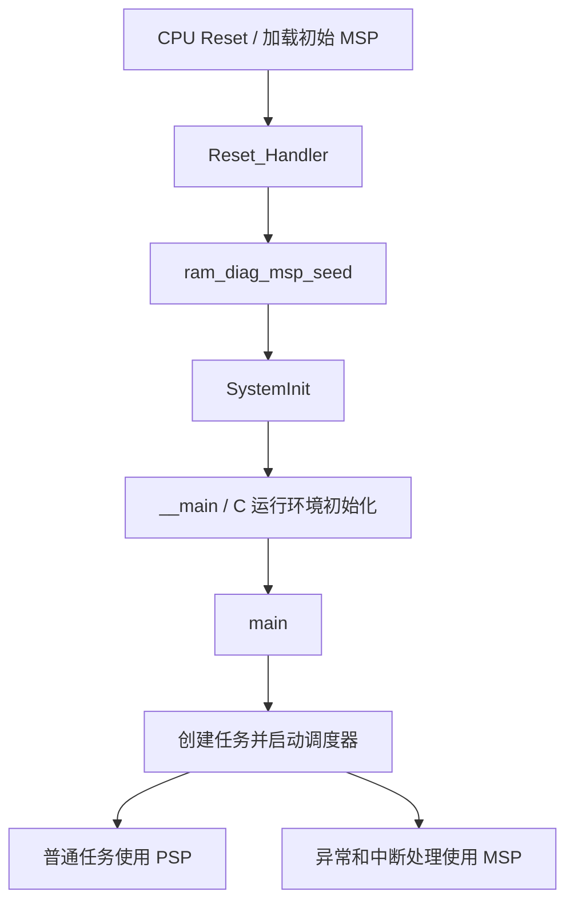
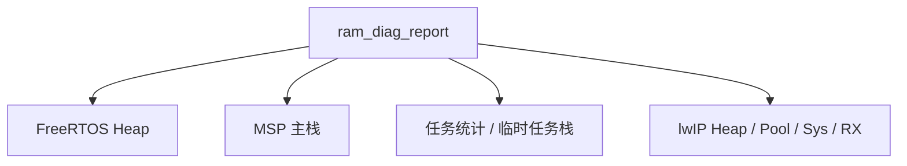

# Cortex-M / FreeRTOS RAM 诊断与 MSP 栈水位分析

> 学习笔记 | 2026-11-26  
> 背景：项目中 Codex 增加了 RAM 运行时诊断模块，目标是了解各类预留 RAM 的实际使用水位，为后续内存优化提供依据。本文按原对话的技术内容整理，并非逐字聊天记录。

## 目录

- [1. 核心问题与结论](#1-核心问题与结论)
- [2. RAM、Heap、MSP、PSP 的关系](#2-ramheapmsppsp-的关系)
- [3. 启动文件与向量表](#3-启动文件与向量表)
- [4. 为什么使用魔数填充](#4-为什么使用魔数填充)
- [5. MSP 初始化汇编逐句解析](#5-msp-初始化汇编逐句解析)
- [6. C 语言扫描和日志统计](#6-c-语言扫描和日志统计)
- [7. FreeRTOS Heap 统计](#7-freertos-heap-统计)
- [8. FreeRTOS 临时任务栈统计](#8-freertos-临时任务栈统计)
- [9. lwIP 内存统计与整体设计](#9-lwip-内存统计与整体设计)
- [10. 诊断开销与代码审查](#10-诊断开销与代码审查)
- [11. 如何利用数据优化 RAM](#11-如何利用数据优化-ram)
- [12. 常见问题速查](#12-常见问题速查)
- [附录：用户提供的完整诊断模块源码](#附录用户提供的完整诊断模块源码)

## 1. 核心问题与结论

最初的问题是：为什么 RAM 诊断需要修改启动汇编？启动文件中的 `Stack_Size` 是不是只给向量表和进入 `main()` 之前的函数使用？对栈填充 `0xA5A5A5A5` 又能代表什么？

**核心结论：**

- `Stack_Size = 0x1500` 预留的是 MSP 主栈，大小为 5376 B（5.25 KiB）。
- MSP 不只在启动阶段使用；典型 Cortex-M FreeRTOS 系统在调度器启动后仍使用 MSP 执行中断和异常处理。
- 向量表本身不使用栈，它只是提供初始 MSP 和异常入口地址。
- 启动阶段使用无栈汇编函数填充魔数，运行后用 C 扫描，从而估算历史栈内存覆盖水位。
- 这不是精确记录历史最低 SP，也不会自动释放 RAM。它是为调整栈配置提供测量依据。
- Map 文件回答「RAM 分配到哪里」，运行时诊断回答「已分配空间使用过多少」。

## 2. RAM、Heap、MSP、PSP 的关系

典型内存布局示意（不表示真实地址顺序）：

```text
整个 RAM
├── 全局变量、静态变量、静态缓冲区
├── MSP 主栈（启动文件预留 5376 B）
├── FreeRTOS Heap
│   ├── 动态任务 A 的栈、TCB
│   ├── 动态任务 B 的栈、TCB
│   ├── 队列、信号量等动态对象
│   └── 尚未分配的空间
└── lwIP Heap / MEMP 等（是否独立取决于配置）
```

| 对象 | 用途 | 统计方法 |
|---|---|---|
| MSP | 启动、异常、中断处理 | 自定义魔数扫描 |
| PSP 对应任务栈 | 普通 FreeRTOS 任务 | `uxTaskGetStackHighWaterMark()` |
| FreeRTOS Heap | 动态分配 | 空闲链表及历史最小剩余 |
| lwIP 内存 | 协议栈堆、内存池 | lwIP 统计计数器 |

MSP 和 PSP 都是 CPU 的栈指针寄存器，不是内存分配器。每个任务有自己的栈，调度器切换任务时保存和恢复相应上下文。

### 2.1 调度器启动前后



| 场景 | 通常使用的栈 |
|---|---|
| `SystemInit()`、`__main`、`main()` 调度前初始化 | MSP |
| `link_identify`、`link_net`、TCP/IP Task、Idle Task | 各自任务栈（PSP） |
| UART、网口、SysTick、PendSV 等 Handler | MSP |
| 嵌套中断 | MSP |

注意：任务被中断时，硬件自动保存的第一层异常现场通常进入被中断任务的 PSP；进入 Handler 模式后的处理函数使用 MSP。若打断的是 Handler，则异常现场也在 MSP。实际细节取决于芯片和 FreeRTOS 移植层。

## 3. 启动文件与向量表

### 3.1 原始代码

```asm
Stack_Size      EQU     0x00001500

                AREA    STACK, NOINIT, READWRITE, ALIGN=3
                EXPORT  __ram_diag_msp_base
__ram_diag_msp_base
Stack_Mem       SPACE   Stack_Size
__initial_sp
```

| 指令或符号 | 含义 |
|---|---|
| `EQU` | 定义汇编常量，类似 C 的 `#define` |
| `AREA STACK` | 定义名为 STACK 的内存段 |
| `NOINIT` | 不要求启动初始化代码清零此段，仍需确认实际链接配置 |
| `READWRITE` | 可读写 |
| `ALIGN=3` | 按 2³ = 8 字节对齐 |
| `SPACE Stack_Size` | 预留指定字节数 |
| `EXPORT` | 导出符号供其他模块引用 |
| `__ram_diag_msp_base` | 栈最低地址，和 `Stack_Mem` 同址 |
| `__initial_sp` | 栈最高边界，初始 MSP 值 |

假设链接器将栈放在 `0x20001000`（仅示例）：

```text
高地址 0x20002500  __initial_sp（边界，不是最后一个字节）
        ┌─────────────────┐
        │ 已使用栈空间     │
        ├─────────────────┤ ← 当前 MSP
        │        ↓        │
        │ 栈向低地址增长   │
        │                 │
        │ 尚未使用空间     │
        └─────────────────┘
低地址 0x20001000  __ram_diag_msp_base / Stack_Mem
```

总大小 = `0x20002500 - 0x20001000 = 0x1500 = 5376 B`。

### 3.2 向量表有什么作用？

典型向量表（示意）：

```asm
__Vectors
    DCD     __initial_sp
    DCD     Reset_Handler
    DCD     NMI_Handler
    DCD     HardFault_Handler
    ; ...
```

CPU 复位时从向量表第一个表项读取初始 MSP，从第二个表项读取 Reset_Handler 入口。向量表通常位于 Flash，只保存地址，不占用这 5376 B 的主栈空间。

### 3.3 修改后的复位入口

```asm
Reset_Handler   PROC
                EXPORT  Reset_Handler             [WEAK]
                IMPORT  __main
                IMPORT  SystemInit
                IMPORT  ram_diag_msp_seed
                ; Seed before any startup C call; the leaf routine uses no stack.
                BL      ram_diag_msp_seed
                LDR     R0, =SystemInit
                BLX     R0
                LDR     R0, =__main
                BX      R0
                ENDP
```

新增的 `BL ram_diag_msp_seed` 放在 `SystemInit()` 之前，是为了尽早建立栈水位测量基准，避免漏掉启动阶段的使用痕迹。

## 4. 为什么使用魔数填充

栈有三个不同的量：

| 指标 | 定义 |
|---|---|
| 预留容量 | `stack_top - stack_base` |
| 当前 SP 深度 | `stack_top - current_msp`（正常栈范围内） |
| 历史覆盖水位 | 总容量减去栈底连续未被覆盖的魔数区域 |

CPU 不会自动提供历史最低 MSP。函数返回时，SP 通常恢复，但原来写入 RAM 的内容通常不会被清除。于是可以预先填充已知模式，之后检查模式被覆盖到什么位置。

```text
高地址 / 栈顶
    刚启动          函数运行时       函数返回后
    A5A5A5A5 ←SP    08001239         08001239 ←SP
    A5A5A5A5        20000300         20000300
    A5A5A5A5        00000008         00000008
    A5A5A5A5        00000001         00000001
    A5A5A5A5        A5A5A5A5 ←SP    A5A5A5A5
    A5A5A5A5        A5A5A5A5         A5A5A5A5
低地址 / 栈底                      ↑ 从这里扫描
```

**SP 恢复了，但内存中的使用痕迹仍然存在。**

`0xA5A5A5A5` 没有特殊硬件功能，只是固定填充模式（Fill Pattern / Magic Number）。它也与 FreeRTOS 常见的任务栈 A5 填充思想相同。

例如 5376 B 栈中，栈底连续 4096 B 仍为 A5，则估算历史覆盖深度为 `5376 - 4096 = 1280 B`。

为什么从栈底开始扫描并在第一个非 A5 处停止？因为需要估算最深覆盖边界，而不是计算所有被改写的字节数量。已经使用过的栈内部也可能包含没有写入的 A5。

## 5. MSP 初始化汇编逐句解析

原代码：

```c
#if LPM11_RAM_DIAG_ENABLE && defined(__CC_ARM)
__asm void ram_diag_msp_seed(void) {
    IMPORT __ram_diag_msp_base
    IMPORT __initial_sp
    LDR r0, =__ram_diag_msp_base
    MRS r1, MSP
    LDR r3, =__initial_sp
    CMP r1, r3
    IT HI
    MOVHI r1, r3
    LDR r2, =0xA5A5A5A5
seed_next
    CMP r0, r1
    BHS seed_done
    STR r2, [r0], #4
    B seed_next
seed_done
    BX lr
    NOP
}
#else
void ram_diag_msp_seed(void) {
    /* Diagnostics-off builds leave the startup stack untouched. */
}
#endif
```

### 5.1 指令解析

| 指令 | 功能 |
|---|---|
| `IMPORT` | 引用外部汇编符号 |
| `LDR r0, =__ram_diag_msp_base` | R0 = 栈底地址 |
| `MRS r1, MSP` | R1 = CPU 当前 MSP |
| `LDR r3, =__initial_sp` | R3 = 预留栈的最高边界 |
| `CMP r1, r3` | 比较当前 MSP 与栈顶 |
| `IT HI` / `MOVHI r1, r3` | 若 R1 无符号大于 R3，将 R1 限制到栈顶 |
| `LDR r2, =0xA5A5A5A5` | R2 = 填充模式 |
| `CMP r0, r1` | 比较写入地址与结束边界 |
| `BHS seed_done` | R0 无符号大于或等于 R1 时退出 |
| `STR r2, [r0], #4` | 写入 4 B，然后 R0 加 4 |
| `B seed_next` | 继续循环 |
| `BX lr` | 通过 LR 中的返回地址返回 |
| `NOP` | 空操作，此处位于返回指令之后 |

核心逻辑的 C 伪代码（仅用于理解，不可直接作为启动填充实现）：

```c
uintptr_t p = stack_base;
uintptr_t end = min(current_msp, stack_top);
while (p < end) {
    *(uint32_t *)p = 0xA5A5A5A5u;
    p += 4;
}
```

实际填充范围是 `[stack_base, min(current_msp, stack_top))`。正常 Reset 时 MSP 通常等于栈顶，因此会写入全部 5376 B，共 1344 个 32 位字。若 MSP 已低于栈顶，则不覆盖其上方正在使用的部分；此时未填充区域的历史水位可信度取决于初始内容。

### 5.2 为什么不用普通 C 函数填充？

普通 C 函数可能生成如下入口和退出指令：

```asm
PUSH {R4, LR}
; 若此处覆盖整个栈，可能破坏保存的寄存器和返回地址
POP  {R4, PC}
```

如果函数自身使用了栈，又覆盖整个栈，就可能破坏自己保存的现场。普通 C 函数也不能仅凭源码保证没有运行库调用或栈访问。

此处汇编只使用 R0–R3、LR，没有 PUSH、POP，也没有调用其他函数。ARM 的 BL 将返回地址写入 LR，不必自动压栈，因此可以构造无栈叶子函数。

不过，无栈函数不等于没有异常入栈风险。若填充时发生异常，仍需考虑异常栈帧是否被覆盖。应保证启动期间满足相应的异常、中断及 RAM 可访问条件。

## 6. C 语言扫描和日志统计

```c
static uint32_t ram_diag_pattern_free_bytes(
    const volatile uint32_t *base, uint32_t bytes)
{
    uint32_t free_bytes = 0u;
    while ((free_bytes < bytes) && (*base == 0xA5A5A5A5u)) {
        free_bytes += sizeof(uint32_t);
        ++base;
    }
    return free_bytes;
}
```

每次读取 4 B，遇到第一个非魔数停止。`volatile` 让编译器按实际内存读取该模式，但不提供原子快照或并发保护。当前实现假设栈边界对齐、长度为 4 的倍数。

```c
extern uint32_t __ram_diag_msp_base;
extern uint32_t __initial_sp;

msp_bytes = (uint32_t)((uintptr_t)&__initial_sp -
                       (uintptr_t)&__ram_diag_msp_base);
msp_free = ram_diag_pattern_free_bytes(&__ram_diag_msp_base, msp_bytes);
```

两个 `extern` 声明用于引用汇编地址标签。这里取的是符号地址 `&symbol`，而非读取符号位置的变量值。

假设日志为：

```text
[RAM][MSP] total=5376 free_min=4160 used_peak=1216 seed=RESET
```

| 字段 | 示例 | 含义 |
|---|---:|---|
| `total` | 5376 | 主栈预留字节数 |
| `free_min` | 4160 | 栈底连续保留魔数的字节数 |
| `used_peak` | 1216 | 估算历史最大覆盖深度 |
| `seed` | RESET | 设计上在复位阶段填充 |

**限制：** `used_peak` 不等于精确的历史最大 SP 深度。如果函数执行 `SUB SP, SP, #256` 但没有实际写入整个栈帧，魔数扫描可能低估真实深度；写入值碰巧等于魔数也可能造成漏检。栈越界、非栈写入等同样会影响统计结果。

## 7. FreeRTOS Heap 统计

原始代码（典型 heap_4 风格）：

```c
#if LPM11_RAM_DIAG_ENABLE
/* Task-context diagnostic only; the allocator lists and policies are unchanged. */
void ram_diag_heap_get_stats(ram_diag_heap_stats_t *stats)
{
    BlockLink_t *block;
    size_t largest = 0U;
    uint32_t count = 0U;
    if (stats == NULL)
        return;
    vTaskSuspendAll();
    for (block = xStart.pxNextFreeBlock; (block != NULL) && (block != pxEnd); block = block->pxNextFreeBlock) {
        if (block->xBlockSize > largest)
            largest = block->xBlockSize;
        ++count;
    }
    stats->free_bytes = (uint32_t)xFreeBytesRemaining;
    stats->min_free_bytes = (uint32_t)xMinimumEverFreeBytesRemaining;
    stats->largest_payload_bytes = (largest > xHeapStructSize) ? (uint32_t)(largest - xHeapStructSize) : 0U;
    stats->free_blocks = count;
    (void)xTaskResumeAll();
}
#endif
```

`vTaskSuspendAll()` 暂停任务调度，避免其他任务在遍历过程中修改空闲链表；并不是关闭中断。这里依赖分配器不在 ISR 中被调用，以及实际移植层提供的调度保护。统计结束恢复调度，不修改内存分配策略。

| 字段 | 含义 |
|---|---|
| `free_bytes` | 当前剩余堆空间 |
| `min_free_bytes` | 历史最少剩余堆空间 |
| `largest_payload_bytes` | 最大空闲块扣除管理头后的空间（实际申请仍受分配器对齐等规则限制） |
| `free_blocks` | 空闲块数量 |

```text
[空闲100B] [已用] [空闲200B] [已用] [空闲50B]
```

总空闲 350 B，最大连续空闲块 200 B，但无法申请 300 B 的连续空间。这就是需要观察最大空闲块和碎片情况的原因。历史最小剩余量由分配器维护，不依赖扫描。

## 8. FreeRTOS 临时任务栈统计

FreeRTOS 提供 `uxTaskGetStackHighWaterMark()`，在相应配置下利用任务创建时的填充模式计算栈水位。但 MSP 并不属于某个 FreeRTOS 任务，因此不能直接用这个 API 统计 MSP。

| 对比 | MSP | 任务栈 |
|---|---|---|
| 分配方式 | 启动文件 / 链接器 | FreeRTOS 动态或静态分配 |
| 填充时机 | Reset_Handler | 任务创建时 |
| 扫描 | 自定义 C 函数 | FreeRTOS API |
| 返回单位 | 字节 | StackType_t 元素（典型 ARM32 为 4 B） |

项目关注 `link_identify` 和 `link_net` 两个临时任务，退出前采集水位，避免任务删除、栈被释放后无法追溯。

```c
free_words = uxTaskGetStackHighWaterMark((TaskHandle_t)handle);
```

每次退出保存本次剩余水位以及历次退出的最小剩余水位。`exits != 0` 表示至少采样一次，不能把未采样时的 0 当成真实栈剩余为 0。

假设 `link_net` 配置 512 words，采样剩余 200 words，且 `sizeof(StackType_t) == 4`：预留 2048 B，估算覆盖水位 `(512 - 200) × 4 = 1248 B`。此为示例，不是实测。

任务创建次数、创建失败次数、栈溢出次数也是诊断指标。注意退出采样不能覆盖未正常退出的任务，也可能漏掉采样后到真正删除之间的栈使用。

## 9. lwIP 内存统计与整体设计



| 日志 | 诊断用途 |
|---|---|
| `[RAM][RTOS]` | 堆剩余、历史最低、碎片、待清理任务 |
| `[RAM][MSP]` | 主栈配置是否有优化空间 |
| `[RAM][TASKS]` | 创建失败、栈溢出 |
| `[RAM][TEMP]` | 临时任务栈是否配置合理 |
| `[RAM][LWIP_HEAP]` | lwIP 堆容量和峰值 |
| `[RAM][LWIP_POOL]` | 各内存池的容量、使用量、峰值和错误 |
| `[RAM][LWIP_SYS]` | 信号量、互斥锁、邮箱对象数量，不是邮箱消息深度 |
| `[RAM][RX]` | 收包分配失败和输入丢包 |
| `[RAM][RX_RETRY]` | 重试与恢复帧情况 |

lwIP 统计在短时间的 `SYS_ARCH_PROTECT` 内复制快照，随后解除保护再打印，以减少临界区开销。各池是分别采样的，不是整个系统同一时刻的原子快照。Heap 容量通常以字节计，MEMP 池通常以对象数量计，具体需要核对本项目 lwIP 配置与类型。

报告入口检查 PoE 扫描和识别任务是否活跃，尽量避免诊断影响时序敏感业务。该检查只是当下的状态判断，不能保证后续始终没有并发活动。

## 10. 诊断开销与代码审查

### 10.1 为什么不新增诊断任务？

诊断本身也消耗 RAM。如果新增 512 words 的诊断任务，在 ARM32 上仅任务栈就可能占用 2048 B，另有 TCB 等开销。

现有实现：

- `s_ram_diag` 通过编译期大小检查限制为 36 B。
- 不新增任务、队列或专用栈填充缓冲区。
- `ram_diag_lwip_stats_t` 在 ARM32 下检查为 20 B，复用调用者栈上的快照。
- 诊断报告局部变量、字符串表、日志函数调用链等仍有 RAM 或栈开销；不能将 36 B 视为完整模块开销。

### 10.2 需要确认的问题

| 检查项 | 原因 / 建议 |
|---|---|
| ARM Compiler 5 / 6 兼容性 | `__CC_ARM` 不成立时可能走空函数，但诊断仍打印 `seed=RESET`。建议显式禁止不支持的诊断构建，或实现对应编译器版本。 |
| 诊断关闭构建 | 启动文件仍无条件调用空函数；需确认该函数反汇编不使用未准备好的运行环境。 |
| 无栈实现 | 检查最终反汇编，确保无 PUSH、POP、运行库访问或额外调用。 |
| 链接符号 | 确认 `__initial_sp` 在其他位置确实有 EXPORT，且两个边界有效。 |
| NOINIT / Scatter | 确认 `SystemInit`、C 运行库不会重新清除或覆盖已填充的栈。 |
| 启动异常 | 确认 seed 期间的中断、NMI 等异常行为不会使栈帧被填充覆盖。 |
| MSP 扫描并发 | 中断开启时，可能错过扫描期间新出现的峰值；后续扫描通常能捕获，不是原子快照。 |
| 水位精度 | 魔数检测是覆盖深度估算，不是最低 SP 的精确记录。 |
| FreeRTOS API 和任务生命周期 | 栈水位接口需启用，采样句柄须有效，采样后不应保留已删除的句柄。 |
| lwIP 配置与计数宽度 | 检查统计宏、池指针有效性、字段类型与 `uint16_t` 快照是否有截断风险。 |
| 统计开销 | 检查日志和扫描对任务栈、中断延迟以及业务时序的影响。 |

这些是基于源码的审查建议，并非已经确认存在的运行故障。尚未提供真实 Map、Scatter 文件、反汇编、芯片型号、FreeRTOS port 或测试日志，因此不能确认实际工程已经满足全部条件。

## 11. 如何利用数据优化 RAM

### 11.1 两个分析层面

1. **静态分配分析：** 通过 Map 文件查看 MSP、RTOS Heap、lwIP 内存池、全局变量、静态缓冲区的真实预留空间。
2. **运行时水位分析：** 通过诊断日志评估这些空间实际使用过多少，是否发生分配失败、碎片、栈溢出等。

不能直接将所有使用量相加：动态任务栈通常已包含在 FreeRTOS Heap 中，lwIP 也可能使用系统堆。需要先确认分配归属。不同模块历史峰值也不一定发生在同一时刻。

### 11.2 MSP 优化示例（假设数据）

假设经过测试观察到历史覆盖峰值约 1024 B：

| 项目 | 原配置 | 候选配置 |
|---|---:|---:|
| Stack_Size | `0x1500` | `0x0800` |
| 预留 RAM | 5376 B | 2048 B |
| 假设覆盖峰值 | 1024 B | 1024 B |
| 表面剩余裕量 | 4352 B | 1024 B |
| 减少预留 | 0 B | 3328 B |

这只是数学示例，不是推荐直接改成 2048 B。覆盖水位可能低估真实栈需求，必须保留安全裕量并重新验证最坏情况。

### 11.3 实际操作流程

- [ ] 保存原始 Map 文件与 RAM 配置，记录当前版本和编译优化等级。
- [ ] 确认 seed 函数和链接边界正确，在复位后检查栈底魔数。
- [ ] 运行完整启动流程、网络高负载、业务任务反复创建和删除。
- [ ] 覆盖中断嵌套、异常路径、错误恢复及极端并发场景。
- [ ] 收集 MSP、任务栈、Heap 和 lwIP 日志，关注峰值和失败计数。
- [ ] 结合反汇编或静态栈分析评估真实最坏栈深度，选择有裕量的配置。
- [ ] 修改配置后重新编译，比较 Map 文件并重复压力测试。
- [ ] 确认节省的 RAM 实际可用于其他模块，而不是仅改变内部水位。

## 12. 常见问题速查

**Q：填充 A5 后是否增加了 RAM 占用？**  
A：填充复用已经预留的 MSP 空间，不额外申请同样大小的缓冲区；诊断模块自身仍有少量静态和运行栈开销。

**Q：MSP 只给 main 之前的函数使用吗？**  
A：不是。调度器启动前通常供普通函数使用，启动后仍供中断和异常处理使用。

**Q：向量表占用这块栈吗？**  
A：不占用。向量表保存初始 MSP 和处理函数地址。

**Q：为什么不直接读取 MSP？**  
A：只能获得当前深度，无法直接还原历史最大深度。

**Q：为什么 seed 需要汇编，扫描却可以用 C？**  
A：seed 在 C 环境初始化之前运行，并且需要避免覆盖自身栈；扫描只是运行期间读取现有内存，通常在任务上下文执行。

**Q：free_min 是可以马上释放给其他模块的 RAM 吗？**  
A：不是。整个 MSP 空间仍然由链接器预留，只有修改栈容量并重新链接，才可能减少预留。

**Q：Codex 加这段汇编有必要吗？**  
A：若目标是全面评估 RAM 配置，MSP 是值得独立测量的区域。原理合理，但应完成上述工程检查后再依赖测量数据做缩容决策。

---

## 附录：用户提供的完整诊断模块源码

以下保留原始实现，便于对照分析；没有擅自修改其逻辑。

```c
/**
 * @date 202611
 * @brief Reports RAM baseline peaks without adding tasks, queues, or buffers.
 */
#include "ram_diag.h"

/* Both symbols bound the actual linker-reserved MSP stack, not the RTOS heap. */
extern uint32_t __ram_diag_msp_base;
extern uint32_t __initial_sp;

#if LPM11_RAM_DIAG_ENABLE && defined(__CC_ARM)
/* No stack, globals, or C runtime access is permitted before SystemInit. */
__asm void ram_diag_msp_seed(void) {
    IMPORT __ram_diag_msp_base
    IMPORT __initial_sp
    LDR r0, =__ram_diag_msp_base
    MRS r1, MSP
    LDR r3, =__initial_sp
    CMP r1, r3
    IT HI
    MOVHI r1, r3
    LDR r2, =0xA5A5A5A5
seed_next
    CMP r0, r1
    BHS seed_done
    STR r2, [r0], #4
    B seed_next
seed_done
    BX lr
    NOP
}
#else
void ram_diag_msp_seed(void) {
    /* Diagnostics-off builds leave the startup stack untouched. */
}
#endif

#if LPM11_RAM_DIAG_ENABLE
#include <stddef.h>
#include <string.h>
#include "FreeRTOS.h"
#include "task.h"
#include "log.h"
#include "link_diag.h"
#include "link_identify.h"
#include "lwip_port.h"
#include "lwip/stats.h"
#include "lwip/sys.h"

/* ARM32: 36 B, align 4; no pointers, implicit padding, or heap ownership. */
typedef struct {
    uint32_t creates;
    uint32_t create_failures;
    uint32_t stack_overflows;
    ram_diag_task_stats_t task[RAM_DIAG_TASK_COUNT];
} ram_diag_runtime_t;
typedef char ram_diag_runtime_size_check_t[(sizeof(ram_diag_runtime_t) == 36u) ? 1 : -1];
static ram_diag_runtime_t s_ram_diag;
static const char *const s_task_names[RAM_DIAG_TASK_COUNT] = {"link_identify", "link_net"};
static const uint16_t s_task_stack_words[RAM_DIAG_TASK_COUNT] = {LINK_IDENTIFY_TASK_STACK_WORDS, 512u};

/* ARM32: 20 B, align 4; one pool snapshot is reused on the caller's stack. */
typedef struct {
    uint16_t capacity;
    uint16_t used;
    uint16_t peak;
    uint16_t reserved;
    uint32_t errors;
    uint32_t illegal;
    const char *name;
} ram_diag_lwip_stats_t;
#if defined(__CC_ARM)
typedef char ram_diag_lwip_size_check_t[(sizeof(ram_diag_lwip_stats_t) == 20u) ? 1 : -1];
#endif

void ram_diag_task_created(const char *name) {
    uint8_t index;
    /* traceTASK_CREATE already holds the kernel critical section. */
    ++s_ram_diag.creates;
    for (index = 0u; index < RAM_DIAG_TASK_COUNT; ++index) {
        if (strcmp(name, s_task_names[index]) == 0) {
            ++s_ram_diag.task[index].creates;
            break;
        }
    }
}

void ram_diag_task_create_failed(void) {
    taskENTER_CRITICAL();
    ++s_ram_diag.create_failures;
    taskEXIT_CRITICAL();
}

void ram_diag_task_exit(uint8_t task_id, void *handle) {
    UBaseType_t free_words;
    ram_diag_task_stats_t *stats;
    if (task_id >= RAM_DIAG_TASK_COUNT)
        return;
    /* Scan before deletion, with interrupts enabled; never retain the handle. */
    free_words = uxTaskGetStackHighWaterMark((TaskHandle_t)handle);
    taskENTER_CRITICAL();
    stats = &s_ram_diag.task[task_id];
    if ((stats->exits == 0u) || (free_words < stats->min_free_words))
        stats->min_free_words = (uint16_t)free_words;
    stats->last_free_words = (uint16_t)free_words;
    ++stats->exits;
    taskEXIT_CRITICAL();
}

void ram_diag_stack_overflow(void) {
    /* Only the overflow hook writes this word; it can run inside PendSV. */
    ++s_ram_diag.stack_overflows;
}

static uint32_t ram_diag_pattern_free_bytes(const volatile uint32_t *base, uint32_t bytes) {
    uint32_t free_bytes = 0u;
    while ((free_bytes < bytes) && (*base == 0xA5A5A5A5u)) {
        free_bytes += sizeof(uint32_t);
        ++base;
    }
    return free_bytes;
}

static void ram_diag_lwip_copy(ram_diag_lwip_stats_t *copy, const struct stats_mem *source) {
    copy->capacity = source->avail;
    copy->used = source->used;
    copy->peak = source->max;
    copy->reserved = 0u;
    copy->errors = source->err;
    copy->illegal = source->illegal;
    copy->name = source->name;
}

static void ram_diag_report_lwip(void) {
    ram_diag_lwip_stats_t sample;
    lwip_port_rx_input_error_stats_t rx;
    struct stats_sys system;
    uint8_t index;
    SYS_ARCH_DECL_PROTECT(level);
    if (!lwip_port_ram_diag_ready())
        return;
    /* Allocations can occur in recv and business workers as well as TCP/IP.
     * Copy counters briefly under the same interrupt protection as pool updates. */
    SYS_ARCH_PROTECT(level);
    ram_diag_lwip_copy(&sample, &lwip_stats.mem);
    system = lwip_stats.sys;
    SYS_ARCH_UNPROTECT(level);
    log_info("[RAM][LWIP_HEAP] capacity=%u used=%u peak=%u err=%lu illegal=%lu\n",
             (unsigned)sample.capacity, (unsigned)sample.used, (unsigned)sample.peak,
             (unsigned long)sample.errors, (unsigned long)sample.illegal);
    /* System statistics count objects, not messages waiting in a mailbox. */
    log_info("[RAM][LWIP_SYS] sem=%lu/%lu/%lu mutex=%lu/%lu/%lu mbox=%lu/%lu/%lu units=used/peak/err\n",
             (unsigned long)system.sem.used, (unsigned long)system.sem.max, (unsigned long)system.sem.err,
             (unsigned long)system.mutex.used, (unsigned long)system.mutex.max, (unsigned long)system.mutex.err,
             (unsigned long)system.mbox.used, (unsigned long)system.mbox.max, (unsigned long)system.mbox.err);
    for (index = 0u; index < MEMP_MAX; ++index) {
        SYS_ARCH_PROTECT(level);
        ram_diag_lwip_copy(&sample, lwip_stats.memp[index]);
        SYS_ARCH_UNPROTECT(level);
        log_info("[RAM][LWIP_POOL] id=%u name=%s capacity=%u used=%u peak=%u err=%lu illegal=%lu\n",
                 (unsigned)index, sample.name, (unsigned)sample.capacity, (unsigned)sample.used,
                 (unsigned)sample.peak, (unsigned long)sample.errors, (unsigned long)sample.illegal);
    }
    lwip_port_get_rx_input_error_stats(&rx);
    log_info("[RAM][RX] pbuf_fail=%lu input_drop=%lu mem=%lu buf=%lu other=%lu\n",
             (unsigned long)lwip_port_get_rx_pbuf_alloc_fail_count(), (unsigned long)rx.total,
             (unsigned long)rx.err_mem, (unsigned long)rx.err_buf, (unsigned long)rx.err_other);
    log_info("[RAM][RX_RETRY] attempts=%lu recovered_frames=%lu max_retries=%u\n",
             (unsigned long)lwip_port_get_rx_input_retry_count(),
             (unsigned long)lwip_port_get_rx_input_recovered_count(), (unsigned)LWIP_PORT_RX_INPUT_RETRY_LIMIT);
}

void ram_diag_report(void) {
    ram_diag_heap_stats_t heap;
    ram_diag_runtime_t runtime;
    uint32_t msp_bytes, msp_free;
    uint8_t index;
    /* Do not print or suspend scheduling while either timing-sensitive scan runs. */
    if (link_diag_poe_scan_active() || (xTaskGetHandle("link_identify") != NULL))
        return;
    ram_diag_heap_get_stats(&heap);
    taskENTER_CRITICAL();
    runtime = s_ram_diag;
    taskEXIT_CRITICAL();
    msp_bytes = (uint32_t)((uintptr_t)&__initial_sp - (uintptr_t)&__ram_diag_msp_base);
    msp_free = ram_diag_pattern_free_bytes(&__ram_diag_msp_base, msp_bytes);
    log_info("[RAM][RTOS] free=%lu min=%lu largest_payload=%lu blocks=%lu cleanup_pending=%lu\n",
             (unsigned long)heap.free_bytes, (unsigned long)heap.min_free_bytes,
             (unsigned long)heap.largest_payload_bytes, (unsigned long)heap.free_blocks,
             (unsigned long)ram_diag_pending_task_cleanup());
    log_info("[RAM][MSP] total=%lu free_min=%lu used_peak=%lu seed=RESET\n",
             (unsigned long)msp_bytes, (unsigned long)msp_free, (unsigned long)(msp_bytes - msp_free));
    log_info("[RAM][TASKS] created=%lu create_fail=%lu stack_overflow=%lu\n",
             (unsigned long)runtime.creates, (unsigned long)runtime.create_failures,
             (unsigned long)runtime.stack_overflows);
    for (index = 0u; index < RAM_DIAG_TASK_COUNT; ++index) {
        log_info("[RAM][TEMP] name=%s stack_words=%u created=%lu exits=%lu sampled=%u free_min_words=%u last_words=%u\n",
                 s_task_names[index], (unsigned)s_task_stack_words[index],
                 (unsigned long)runtime.task[index].creates, (unsigned long)runtime.task[index].exits,
                 (unsigned)(runtime.task[index].exits != 0u), (unsigned)runtime.task[index].min_free_words,
                 (unsigned)runtime.task[index].last_free_words);
    }
    ram_diag_report_lwip();
}
#endif
```
