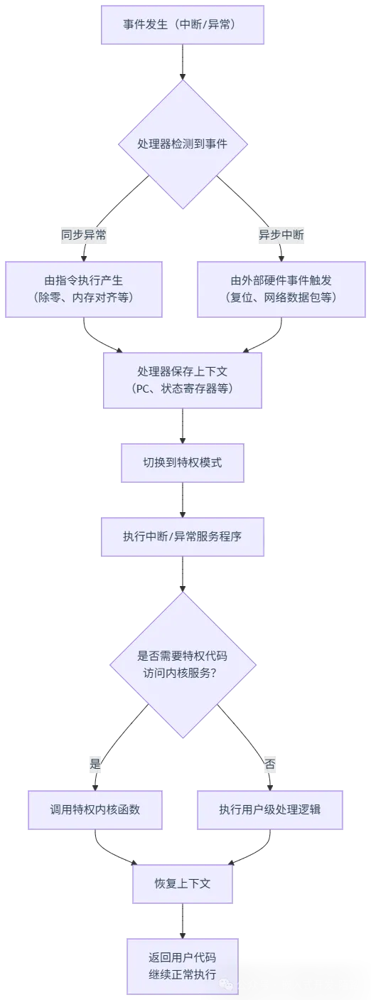

# Zephyr_RTOS

## 一、概念

### 1.1、中断与异常

链接：[【Zephyr开发系列-2】二.实时操作系统RTOS](https://mp.weixin.qq.com/s?__biz=MzY5NjM0NjI1MQ==&mid=2247483661&idx=1&sn=a1a529be315b014612f07271fd8f333f&chksm=f46f72e9c318fbffecc5d26f54747571925f67d68186222e7a8847adcbac13e658e75e48adf0&cur_album_id=4551460587331125261&scene=189#wechat_redirect)

- **异常（Exception）** = **同步**事件（由指令执行触发，如除零、缺页、系统调用）。
- **中断（Interrupt）** = **异步**事件（由外部硬件触发，如 I/O 设备、定时器）。

- **同步异常（Exceptions）**：由当前正在执行的指令**主动**引发。程序计数器（PC）在异常发生时通常指向导致异常的指令（或下一条），它是**可重现**的。
- **异步异常（Interrupts）**：由处理器外部的硬件信号**被动**触发。它与当前执行到哪条指令无关，具有**随机性**，处理完成后通常返回下一条指令。



### 1.2、同步异常

  同步异常出现在任务线程执行的特定时刻，由当前正在执行的指令直接触发。根据处理器能否精确定位异常来源，可进一步细分为：

- 精确异常

  ：处理器的程序计数器（PC）精确指向导致异常的指令。异常处理完成后，处理器可准确返回到该指令或下一条指令继续执行。大多数现代处理器（如 ARM Cortex-M 系列）的同步异常均为精确异常。

- 非精确异常

  ：程序计数器不精确指向导致异常的指令。在大量使用流水线或预取算法的处理器架构中，可能产生非精确异常，给异常定位和恢复带来困难。

> **典型同步异常示例**：除零错误、非法指令、内存访问违例、总线错误、系统调用（SVC）等。
>
> **除零错误**： 处理器执行除法指令时，除数为 `0`
>
> **非法指令**：PC（程序计数器）指向的内存区域，读出的二进制数据不是有效的CPU指令码。
>
> - **MCU例子:** 函数指针被意外赋值为一个随机地址（如0xFFFFFFFF），跳转执行时触发 `UsageFault`。
> - **SoC例子:** 程序跑飞，跳到数据段（如`.data`区）执行，触发 `Undefined Instruction` 异常，Linux给进程发 `SIGILL` 信号。
>
> **内存访问违例（MPU / MMU 保护）**:当前特权级（用户态）试图访问**不允许访问**的内存区域（如内核专用RAM、外设寄存器），或试图**写入只读区域**。
>
> - **MCU例子（Cortex-M + MPU）**：用户态代码直接赋值修改一个只读的外设控制寄存器（如时钟使能寄存器），触发 `MemManage Fault`。
> - **SoC例子（Linux用户程序）**：用户态程序用野指针写入内核地址空间（如地址0），触发 `Segmentation Fault (SIGSEGV)`，进程崩溃。
>
> **系统调用（SVC / 软中断）**：用户代码**主动**发起的一条特殊指令，用于**请求内核**帮它做它没权限做的事（如操作硬件、创建线程）。**它不是错误，而是用户态进入内核态的唯一合法“门票”**。
>
> - **MCU例子（FreeRTOS）**：用户任务调用 `taskYIELD()` 或 `portSVCHandler`，通过 `SVC #0` 指令陷入特权模式，让内核切换任务。
> - **SoC例子（Linux）**：用户程序调用 `open()` / `read()` 等C库函数，底层执行 `SWI`（ARM）或 `syscall`（x86）指令，触发异常，内核接管执行驱动代码。

### 1.3、异步异常（中断）

  异步异常可能在任务线程执行的任何时间或位置发生，与当前执行指令无直接因果关系。根据软件能否控制其响应，可细分为：

- 可屏蔽中断

  ：可由软件通过设置处理器状态寄存器中的中断屏蔽位来阻塞或启用。例如，外设中断（定时器、UART、GPIO）通常都是可屏蔽的。

- 不可屏蔽中断（NMI）

  ：无法被软件阻塞，处理器必须无条件响应。例如，硬件复位异常、看门狗超时、电源故障检测等始终是不可屏蔽的。

### 1.4、异常处理流程

  当异常或中断发生时，处理器会执行以下标准流程：

1. 保存上下文

   ：处理器自动保存当前任务的部分或全部寄存器状态（如 PC、堆栈指针、程序状态字等）。

2. 查找入口

   ：加载用于处理该异常或中断的函数的地址（入口点），通常通过中断向量表查找。

3. 转移控制

   ：将控制权转移给异常/中断处理程序执行。

4. 恢复与返回

   ：处理程序完成工作后，恢复之前保存的处理器状态信息，并执行中断返回指令。

  从中断返回时，调度器可以介入并决定被中断的任务是否可以继续运行，或者是否应暂停当前任务，调度一个更高优先级的任务来替代它运行。

### 1.5、同步异常 vs 异步异常：对比总结

| 对比维度       | 同步异常                     | 异步异常（中断）     |
| :------------- | :--------------------------- | :------------------- |
| 触发时机       | 指令执行特定时刻             | 任意时刻             |
| 与当前指令关系 | 直接相关                     | 无关                 |
| 可预测性       | 可预测（相同条件下必然发生） | 不可预测             |
| 典型来源       | CPU 内部错误、系统调用       | 外设、硬件信号       |
| 可屏蔽性       | 通常不可屏蔽                 | 可屏蔽或不可屏蔽     |
| 处理优先级     | 通常高于普通中断             | 取决于中断优先级配置 |

### 1.6、基本通信模式

#### 1.6.1、信号中心通信

  所有必要信息都包含在事件信号本身中。接收方仅通过信号的到来即可获知发生了特定事件，无需额外传递数据。例如，一个任务向另一个任务发送一个"数据已就绪"的信号，接收方收到信号后便知道可以去取数据了。

#### 1.6.2、数据中心通信

  信息通过传输的数据来承载。发送方不仅发送事件信号，还附带具体的数据内容。接收方从接收到的数据中提取所需信息进行处理。例如，一个传感器任务将采集到的温度值通过消息队列发送给处理任务。

#### 1.6.3、耦合方式与具体实现模式

##### 1.6.3.1、松耦合通信

  数据生产者不需要来自数据消费者的响应。生产者只管发送数据或事件，不关心消费者是否收到、何时处理。典型场景包括：

- ISR 在消息队列上发布消息后立即返回
- 任务通过广播方式发送状态更新，无需等待确认

##### 1.6.3.2、紧耦合通信

  涉及数据的双向传输。通常，数据生产者会同步地等待其数据传输的响应，然后再继续执行；或者响应会异步返回，同时生产者继续处理。例如，任务 A 将消息写入由任务 B 读取的消息队列，而任务 B 将消息写入由任务 A 读取的（另一个）消息队列，形成请求-响应的交互模式。

### 1.7、守护任务模式

  一种实现场景是：每个中断服务程序将其数据插入对应的消息队列，并对信号量执行释放操作。守护任务阻塞并等待该信号量（获取操作）。当数据可用时，它先进入临界区，处理可用数据，然后推出临界区。以下是一个代码示例，展示如何创建守护任务、信号量和消息队列，实现多中断源数据接收与守护任务统一处理：

```c

/* 二值信号量，多源通知 */
SemaphoreHandle_t xDataReadySem;
/* 每个中断源对应一个消息队列 */
QueueHandle_t xUartQueue, xAdcQueue;
/* -------- UART 中断服务程序 -------- */
void UART_IRQHandler(void) {
    BaseType_t xWoken = pdFALSE;
    Msg_t msg = { .src = SRC_UART, .val = UART->DR };
    xQueueSendFromISR(xUartQueue, &msg, &xWoken);
    xSemaphoreGiveFromISR(xDataReadySem, &xWoken);
    portYIELD_FROM_ISR(xWoken);
}
/* -------- ADC 中断服务程序 -------- */
void ADC_IRQHandler(void) {
    BaseType_t xWoken = pdFALSE;
    Msg_t msg = { .src = SRC_ADC, .val = ADC->DR };
    xQueueSendFromISR(xAdcQueue, &msg, &xWoken);
    xSemaphoreGiveFromISR(xDataReadySem, &xWoken);
    portYIELD_FROM_ISR(xWoken);
}
/* -------- 守护任务：等待信号量，清空所有队列 -------- */
void vGuardianTask(void *pv) {
    Msg_t msg;
    for (;;) {
        /* 阻塞等待任意中断给出的信号量 */
        xSemaphoreTake(xDataReadySem, portMAX_DELAY);
        taskENTER_CRITICAL();   /* 相当于 disable(interrupts) */
        /* 逐一处理每个队列，清空所有积压消息 */
        while (xQueueReceive(xUartQueue, &msg, 0) == pdTRUE) {
            taskEXIT_CRITICAL();
            ProcessUart(&msg);          /* 耗时处理在临界区外 */
            taskENTER_CRITICAL();
        }
        while (xQueueReceive(xAdcQueue, &msg, 0) == pdTRUE) {
            taskEXIT_CRITICAL();
            ProcessAdc(&msg);
            taskENTER_CRITICAL();
        }
        taskEXIT_CRITICAL();   /* 相当于 enable(interrupts) */
    }
}

/*
**说明**：
- 多源汇聚 
  ：所有中断向同一个信号量给出，唤醒守护任务；每个源拥有独立消息队列，避免混存。

- 清空队列
  ：被唤醒后，守护任务在临界区内循环读取每个队列，直到为空，保证不丢数据。

- 临界区保护
  ：取消息时保持临界区，但处理每条消息时临时退出临界区，防止长时间关中断。
  */
```

另一种场景是：守护任务拥有多个数据输入源（生成输入数据的任务）和多个事件输入源（生成输入数据的中断服务程序），并使用一个事件寄存器，其中每个给定输入被分配到事件寄存器中的特定位，使用计数信号量进行事件累积（每个事件输入源对应一个），并为每个数据输入源使用一个消息队列。在此场景中，数据生产者将消息放入其消息队列，并设置事件寄存器中的相应位。中断服务程序递增其计数信号量，并设置事件寄存器中的相应位。

```c

/* 事件组、队列、计数信号量 */
EventGroupHandle_t xEvents;
QueueHandle_t      xDataQueue;
SemaphoreHandle_t  xTimerSem;      /* 累积定时器事件 */
#define EVT_DATA  (1<<0)
#define EVT_TIMER (1<<1)
/* -------- 数据生产者（任务）-------- */
void vDataTask(void *pv) {
    Msg_t msg;
    while (1) {
        produce(&msg);
        xQueueSend(xDataQueue, &msg, portMAX_DELAY);
        xEventGroupSetBits(xEvents, EVT_DATA);  /* 仅设位，不累积 */
    }
}
/* -------- 定时器 ISR -------- */
void vTimerISR(void) {
    BaseType_t wake = pdFALSE;
    xSemaphoreGiveFromISR(xTimerSem, &wake);               /* 事件+1 */
    xEventGroupSetBitsFromISR(xEvents, EVT_TIMER, &wake);  /* 设位 */
    portYIELD_FROM_ISR(wake);
}
/* -------- 守护任务：统一等待与处理 -------- */
void vDaemonTask(void *pv) {
    while (1) {
        /* 等待任意事件，返回后自动清除所等待的位 */
        EventBits_t bits = xEventGroupWaitBits(
            xEvents, EVT_DATA | EVT_TIMER, pdTRUE, pdFALSE, portMAX_DELAY);
        /* 数据通道：循环读空队列，避免积压 */
        if (bits & EVT_DATA) {
            Msg_t msg;
            while (xQueueReceive(xDataQueue, &msg, 0) == pdTRUE)
                handleData(&msg);
        }
        /* 定时器通道：临界区“吸干”信号量，获得实际次数 */
        if (bits & EVT_TIMER) {
            uint32_t cnt = 0;
            taskENTER_CRITICAL();
            while (xSemaphoreTake(xTimerSem, 0) == pdTRUE) cnt++;
            taskEXIT_CRITICAL();
            if (cnt > MAX_MISSED) recover(); else handleTicks(cnt);
        }
    }
}
/*
说明

事件组代替寄存器：
 每个源占一位，等待任意位即唤醒，退出时自动清除已等待位，无虚假唤醒。
 
队列清空：
 数据生产者只置位一次，守护任务被唤醒后循环读取直到队列为空，防止事件丢失。
 
信号量累积 ISR：
 中断内 Give 计数，守护任务在临界区非阻塞全部取走，集中处理，避免频繁上下文切换。
*/

/*
解决痛点和使用场景：
痛点一（数据）：数据生产很快，如果每次来数据都唤醒任务，会导致“抖动”（频繁切换）。所以用队列缓存数据，用事件组做“敲门砖”——只要队列非空，就置位EVT_DATA，守护任务被唤醒后一次性把队列里积压的所有数据全部处理完。

痛点二（定时器）：定时器中断可能来得很快（比如每100us一次），而守护任务处理数据可能需要1ms。如果每次中断都直接唤醒任务，任务会被打断100次，CPU浪费严重。所以用信号量（xTimerSem）做“计数器”，中断里只give（计数+1），守护任务在收到EVT_TIMER事件后，一次性把这段时间内所有累积的定时器中断次数全部取走，然后只调用一次handleTicks(cnt)，比如“这次我错过了50个Tick，我直接跳转50个时间单位”。

这个设计最适合的场景是：
定时器中断频率远高于任务处理频率（比如电机控制中的PWM周期计算）。
数据是突发性的（比如网卡收到一包数据，但包内包含几百个采样点）。
你不关心单个中断的实时性，只关心“在一段时间内，总共发生了多少次”以及“最新的数据是什么”。
*/
```

### 1.8、任务间发送紧急/高优先级数据

流数据通道不支持数据优先级划分。实现流外高优先级数据发送的一种方法是使用紧急消息队列来处理此类数据，而常规数据则进入普通消息队列。当数据生成任务或 ISR 有常规数据时，它会将该数据放入其普通数据消息队列中。然而，当数据生成任务或 ISR 有需要处理的紧急数据时，它会将该数据放入紧急消息队列，并向消费者任务发送信号。消费者任务的紧急数据信号处理程序从紧急数据消息队列中检索紧急数据并进行处理。

```c

/* 全局句柄 */
QueueHandle_t xNormalQueue, xUrgentQueue;
QueueSetHandle_t xQueueSet;
SemaphoreHandle_t xUrgentFlowSem; /* 计数信号量，限制在途紧急消息数 */
/*-----------------------------------------------------------*/
/* 生产者：按数据类型放入对应队列，紧急消息受流控限制 */
void vProducerTask(void *pv) {
    while(1){
        if (isUrgent()) {
            /* 流控：尝试获取信号量，失败则丢弃或等待 */
            if (xSemaphoreTake(xUrgentFlowSem, 0) == pdTRUE) {
                xQueueSend(xUrgentQueue, &urgentData, 0);
            }
        } else {
            xQueueSend(xNormalQueue, &normalData, 0);
        }
        vTaskDelay(pdMS_TO_TICKS(100));
    }
}
/*-----------------------------------------------------------*/
/* 消费者：通过队列集等待任意队列，永远优先处理紧急队列 */
void vConsumerTask(void *pv) {
    QueueSetMemberHandle_t activeQueue;
    Message_t msg;
    while(1) {
        activeQueue = xQueueSelectFromSet(xQueueSet, portMAX_DELAY);
        /* 优先处理紧急队列直到清空 */
        if (activeQueue == xUrgentQueue) {
            while (xQueueReceive(xUrgentQueue, &msg, 0) == pdTRUE) {
                processUrgent(&msg);
                xSemaphoreGive(xUrgentFlowSem); /* 归还流控配额 */
            }
        }
        /* 其次处理普通队列 */
        else if (activeQueue == xNormalQueue) {
            if (xQueueReceive(xNormalQueue, &msg, 0) == pdTRUE) {
                processNormal(&msg);
            }
        }
    }
}
/*
说明
紧急数据优先级
：消费者通过队列（xQueueSelectFromSet）被唤醒后，先检查并清空紧急队列，实现流外高优先级传输。

流控保护
：计数信号量限制在途紧急消息上限，防止突发紧急数据耗尽内存或阻塞普通数据。
*/
```

## 二、奇奇怪怪的名词

### 2.1、特性

**"提供 POSIX pthreads 兼容 API" = 你的多线程代码可以按照 Linux 上熟悉的方式写，然后在嵌入式平台上直接编译运行，不用学新 API，不用改代码。**

## 三、内核服务

