# 一、移植篇

参考链接，[7. 无操作系统移植LwIP — [野火\]LwIP应用开发实战指南—基于野火STM32 文档](https://doc.embedfire.com/net/lwip/zh/latest/doc/chapter7/chapter7.html)

## 1.1、加入项目的过程

先在GitHub提取lwip源码，如下说明。

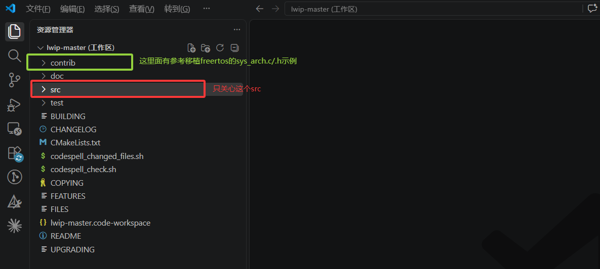

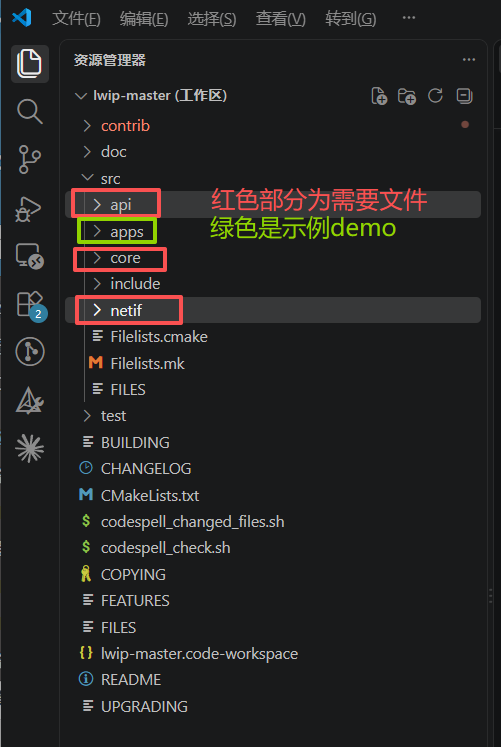

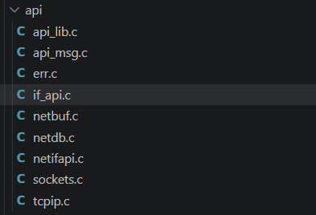

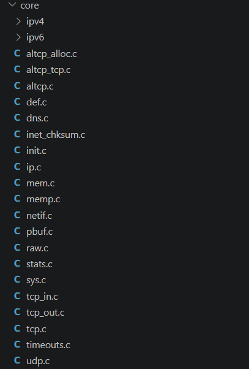

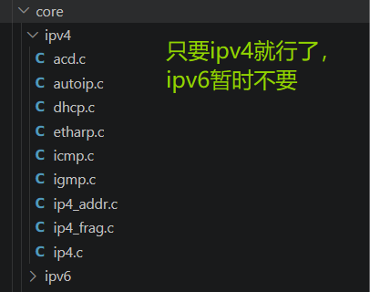

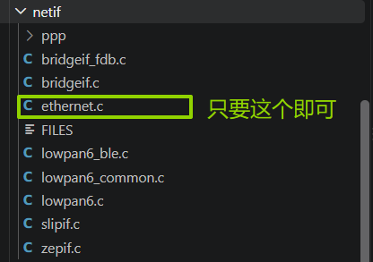

keil中的分结果如下，以n32g455的eth/tcpserver示例，问就是野火和正点的上来写得就按照他们的风格来改省略很多东西，但是初学者应该都好奇改了哪些东西吧？我反正好奇！

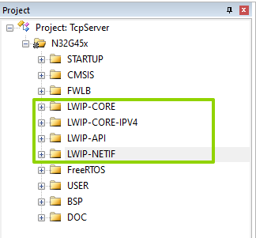

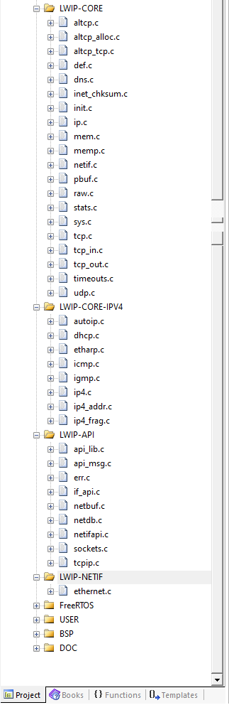

这样丢进去后还有一个头文件路径包含：
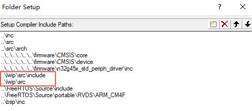

先看下n32的lwip在整个sdk包中的位置！

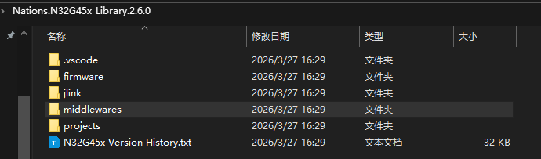

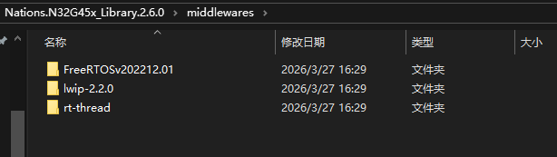

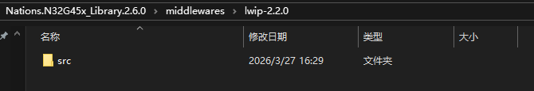

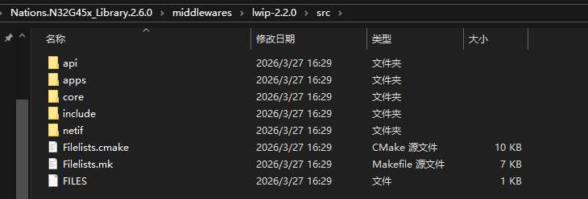

反正 我觉得这样非常清楚的就没啥奇奇怪怪的文件路径包含，对于我这种小白最友好了，我起码知道源码下下来后我只需要把哪部分弄进项目中，包含什么文件吧！

**最关键部分！！！**

现在先以freertos的视角了做支持！那么按照上面步骤只是把lwip加入了项目里面，但是freertos和lwip怎么拼起来通信呢？那lwip肯定要提供个port或者arch文件来把接口或者注册的函数接口出来吧？我们好把freertos的task创建，信号量，队列，锁等给lwip使用。这里需要介绍下，lwip可以在raw，netconn, socket。 自需要了解raw是单线程跑，后面两个可以创建多任务分担整个lwip中的每个子模块的处理。好了废话不多说，支持下面两个文件：

```shell
lwip源码下的prot支持！
lwip\lwip-master\contrib\ports\freertos\include\arch\sys_arch.h
lwip\lwip-master\contrib\ports\freertos\sys_arch.c
```

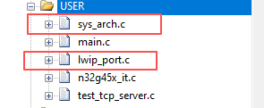

> 注：lwip_port.c是下节内容，这个主要是将lwip数据的发送和接收接口做好的。

通过n32的示例与官方的sys_arch.h，sys_arch.c对比发现，只有sys_arch.c需要注意下：

```c
/*------------------------------------------------------------------*/
/** Set this to 1 if you want the stack size passed to sys_thread_new() to be
 * interpreted as number of stack words (FreeRTOS-like).
 * Default is that they are interpreted as byte count (lwIP-like).
 */
#ifndef LWIP_FREERTOS_THREAD_STACKSIZE_IS_STACKWORDS
#define LWIP_FREERTOS_THREAD_STACKSIZE_IS_STACKWORDS 1
#endif
/*
lwip官方的这里支持是0, n32支持是1.
*/
```

| 设置                                                         | `stacksize` 含义      | FreeRTOS 实际分配                                            | 适用场景                                       |
| :----------------------------------------------------------- | :-------------------- | :----------------------------------------------------------- | :--------------------------------------------- |
| **`#define LWIP_FREERTOS_THREAD_STACKSIZE_IS_STACKWORDS 1`** | **栈字数**（Word 数） | `stacksize` 直接作为 `uxStackSize` 参数传给 `xTaskCreate()`  | 使用 FreeRTOS 原生风格，与 FreeRTOS 文档一致   |
| **`#define LWIP_FREERTOS_THREAD_STACKSIZE_IS_STACKWORDS 0`** | **字节数**（Bytes）   | 内部会换算：`stacksize / sizeof(StackType_t)` 再传给 `xTaskCreate()` | 兼容 lwIP 原生风格，保持与 lwIP 其他移植一致性 |

------

```c
/*实际影响示例
假设在 N32（ARM Cortex-M4，32位）上：

宏设置	TCPIP_THREAD_STACK_SIZE 定义	实际栈字节数
= 1（字数模式）	2048	2048 × 4 = 8192 字节
= 0（字节模式）	2048	2048 / 4 = 512 个字 = 2048 字节
⚠️ 如果不理解这个区别，很容易出问题：

在字数模式下用字节数值（如 8192）→ 实际分配 32KB，可能造成内存浪费或栈溢出（因为超出 heap 限制）

在字节模式下用字数数值（如 2048）→ 实际只分配 2KB，可能导致栈溢出崩溃

如何选择？
选择					理由
推荐 1	① FreeRTOS 官方文档和示例都用字数；② 与 FreeRTOS 配置 configMINIMAL_STACK_SIZE 等单位一致；③ 更直观，避免误以为单位是字节
选择 0	① 需要与 lwIP 官方移植保持严格一致；② 已有大量 lwIP 配置头文件按字节单位定义好了栈大小，改起来麻烦*/
```


```c

//n32的示例的sys_arch.h
u32_t sys_arch_mbox_tryfetch(sys_mbox_t* mbox, void** msg)
{
    BaseType_t ret;
    void* msg_dummy;
    LWIP_ASSERT("mbox != NULL", mbox != NULL);
    LWIP_ASSERT("mbox->mbx != NULL", mbox->mbx != NULL);

    if (!msg)
    {
        msg = &msg_dummy;
    }

    ret = xQueueReceive(mbox->mbx, &(*msg), 0);
    if (ret == errQUEUE_EMPTY)
    {
        *msg = NULL;
        return SYS_MBOX_EMPTY;
    }
    LWIP_ASSERT("mbox fetch failed", ret == pdTRUE);

    /* Old versions of lwIP required us to return the time waited.
       This is not the case any more. Just returning != SYS_ARCH_TIMEOUT
       here is enough. */
    return 1;
}

//lwip官方的是：
u32_t sys_arch_mbox_tryfetch(sys_mbox_t* mbox, void** msg)
{
    BaseType_t ret;
    void* msg_dummy;
    LWIP_ASSERT("mbox != NULL", mbox != NULL);
    LWIP_ASSERT("mbox->mbx != NULL", mbox->mbx != NULL);

    if (!msg)
    {
        msg = &msg_dummy;
    }

    ret = xQueueReceive(mbox->mbx, &(*msg), 0);
    if (ret == errQUEUE_EMPTY)
    {
        *msg = NULL;
        return SYS_MBOX_EMPTY;//0xffffffff
    }
    LWIP_ASSERT("mbox fetch failed", ret == pdTRUE);

    return 0;
}
/*
1.4.1 之前:
sys_arch_mbox_tryfetch 的返回值含义是 “等待的时间”（ticks）。即使是非阻塞的 tryfetch，成功时也需要返回一个非 SYS_ARCH_TIMEOUT 的值（通常是 0 或 1），表示“立即获取成功，没有等待”。所以示例中返回 1 是旧版本的惯用写法。
1.4.1 及之后特别是 2.x:
API 语义明确改为：
返回 0 表示成功（非阻塞获取到消息）
返回 SYS_MBOX_EMPTY（通常定义为 0xFFFFFFFF）表示队列为空
官方代码返回 0 正是遵循这个新规范。
*/

```

以上就是能将lwip与freertos关联起来了，其实也就是给了lwip的运行发送，因为freertos的支持功能（任务创建运行，锁，信号量，队列，消息邮箱等）都给了lwip了。

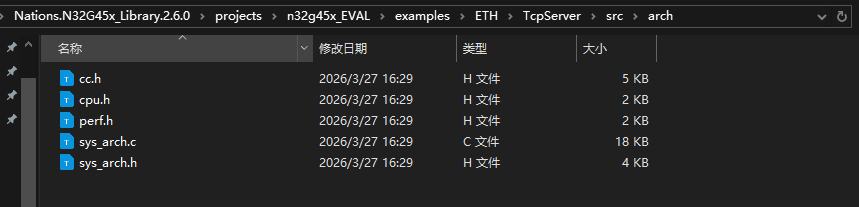

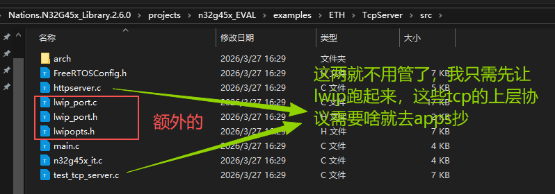

```C
//lwipopts.h
//一般来说LwIP默认会有参数的配置，存放在opt.h文件中，如果用户没有在lwipopts.h文件进行配置，那么LwIP就会使用opt.h默认的参数. 一般改lwipopts.h
 /**
 * NO_SYS==1: Provides VERY minimal functionality. Otherwise,
 * use lwIP facilities.
 */
 #define NO_SYS                  0

//其他的参考下板子的相关的设计

```

```c
//cc.h文件中包含处理器相关的变量类型、数据结构及字节对齐的相关宏。
//freertos的port可没有这个，需要参考别家的移植了
```

```C
//perf.h文件是与系统统计与测量相关的头文件
//暂无使用，默认定义即可如：
/**
 * @file perf.h
 * @author Nations
 * @version v1.0.0
 *
 * @copyright Copyright (c) 2019, Nations Technologies Inc. All rights reserved.
 */
#ifndef __PERF_H__
#define __PERF_H__

#define PERF_START   /* null definition */
#define PERF_STOP(x) /* null definition */

#endif /* __PERF_H__ */

```

```c
//cpu.h 
/**
 * @file cpu.h
 * @author Nations
 * @version v1.0.0
 *
 * @copyright Copyright (c) 2019, Nations Technologies Inc. All rights reserved.
 */
#ifndef __CPU_H__
#define __CPU_H__

#define BYTE_ORDER LITTLE_ENDIAN

#endif /* __CPU_H__ */
```

剩下的是网口驱动（实现将外面的数据和lwip交互起来的接口）。


## 1.2、一般的ETH接口驱动

大多数例程如正点，野火一般用的eth(mac层)+phy(外部以太网芯片)。也有其他的接口暂时不介绍，也有些如沁恒的把tcp协议继承到芯片中了，这种就更方便二次开发了。

其实也简单就支持以下三个接口即可！

```c
static err_t init_eth(struct netif* netif_dev);//初始化
static struct pbuf* low_level_input(struct netif* netif);//数据接收
static err_t low_level_output(struct netif* netif, struct pbuf* p);//数据发送
```

```c
//init
static err_t init_eth(struct netif* netif_dev);//初始化

	tcpip_init(NULL, NULL); //这个必须先初始化。

	ip_addr_t ip, msk, gw;
#if LWIP_DHCP
    ip.addr  = 0;
    msk.addr = 0;
    gw.addr  = 0;
#else  // !LWIP_DHCP
    IP4_ADDR(&ip, 10, 70, 54, 39);
    IP4_ADDR(&msk, 255, 255, 255, 0);
    IP4_ADDR(&gw, 10, 70, 54, 10);
#endif // LWIP_DHCP
netif_add(&netif_dev, &ip, &msk, &gw, NULL, init_eth, tcpip_input);//
//init_eth初始化 如硬件的mac层, lwip相关的如接收接口, mac地址, 最大数据帧长, 还有flags如广播,arp, linkup, igmp等。不过spi的情况下有另外的写法！！！
//如下例子:
static err_t init_eth(struct netif* netif_dev)
{
    log_func();

    RCC_EnableAPB2PeriphClk(RCC_APB2_PERIPH_AFIO | RCC_APB2_PERIPH_GPIOA | RCC_APB2_PERIPH_GPIOB | RCC_APB2_PERIPH_GPIOC
                                | RCC_APB2_PERIPH_GPIOD | RCC_APB2_PERIPH_GPIOE | RCC_APB2_PERIPH_GPIOF
                                | RCC_APB2_PERIPH_GPIOG,
                            ENABLE);

    // MII/RMII should be configured before enabling ETH clock
    GPIO_ETH_ConfigMediaInterface(ETH_INTERFACE == ETH_INTERFACE_MII ? GPIO_ETH_MII_CFG : GPIO_ETH_RMII_CFG);

    RCC_EnableAHBPeriphClk(RCC_AHB_PERIPH_ETHMAC, ENABLE);

    // ETH->MACPMTCTRLSTS |= 0x80000000;
    NVIC_PriorityGroupConfig(NVIC_PriorityGroup_4);
    NVIC_SetVectorTable(NVIC_VectTab_FLASH, 0x0);
    /* Enable the Ethernet global Interrupt */
    NVIC_InitType NVIC_InitStructure;
    NVIC_InitStructure.NVIC_IRQChannel                   = ETH_IRQn;
    NVIC_InitStructure.NVIC_IRQChannelPreemptionPriority = 12;
    NVIC_InitStructure.NVIC_IRQChannelSubPriority        = 0;
    NVIC_InitStructure.NVIC_IRQChannelCmd                = ENABLE;
    NVIC_Init(&NVIC_InitStructure);

    ETH_ConfigGpio(ETH_INTERFACE, REMAP_MODE);

    ETH_MACDMA_Config();

#if LWIP_NETIF_HOSTNAME // LWIP_NETIF_HOSTNAME
    netif_dev->hostname = "n32g45x_lwip";
#endif
    netif_dev->name[0]    = 'n';
    netif_dev->name[1]    = 's';
    netif_dev->output     = etharp_output;    // send packet function for IP layer
    netif_dev->linkoutput = low_level_output; // send packet function for ARP
    memcpy(netif_dev->hwaddr, mac_address, 6);
    netif_dev->hwaddr_len = 6;
    netif_dev->mtu        = 1500; // the max transmit unit, 1500 for ethernet
    netif_dev->flags      = NETIF_FLAG_BROADCAST | NETIF_FLAG_ETHARP | NETIF_FLAG_LINK_UP | NETIF_FLAG_IGMP;

    netif_set_default(netif_dev);
    netif_set_up(netif_dev);
    netif_set_link_up(netif_dev);
    return ERR_OK;
}
//tcpip_input:
//目的是为了注册一个消息邮箱
  msg->type = TCPIP_MSG_INPKT;
  msg->msg.inp.p = p;
  msg->msg.inp.netif = inp;
  msg->msg.inp.input_fn = input_fn;
  if (sys_mbox_trypost(&tcpip_mbox, msg) != ERR_OK) {
    memp_free(MEMP_TCPIP_MSG_INPKT, msg);
    return ERR_MEM;
  }
```

```c
//数据接收
p = low_level_input(&netif_dev); 

static struct pbuf* low_level_input(struct netif* netif)
{
    struct pbuf *p, *q;
    uint32_t len;
    int l = 0;
    uint8_t* buffer;
    p   = NULL;
    len = ETH_GetRxPacketSize();
    if (len == 0)
    {
        return NULL;
    }
    if (ETH_ERROR == ETH_RxPacket(s_Buffer, /*checkErr=*/1))
    {
        return NULL;
    }

    buffer = (uint8_t*)s_Buffer;
    p      = pbuf_alloc(PBUF_RAW, len, PBUF_POOL);
    if (p != NULL)
    {
        for (q = p; q != NULL; q = q->next)
        {
            memcpy((u8_t*)q->payload, (u8_t*)&buffer[l], q->len);
            l = l + q->len;
        }
    }
#if NETIF_DEBUG
    log_debug("recv packet, len: %d, data: ", l);
    dumphex(buffer, l);
    log_debug("\r\n");
#endif

    return p;
}

void recv_task(void* p)
{
    log_func();
    while (1)
    {
        if (ulTaskNotifyTake(pdTRUE, portMAX_DELAY) > 0) // packet received event
        {
            err_t err;
            struct pbuf* p;
            while (1)
            {
                p = low_level_input(&netif_dev); // call low_level_input to receive
                if (p == NULL)
                {
                    break;
                }
                err = netif_dev.input(p, &netif_dev); // process packet
                if (err != ERR_OK)
                {
                    LWIP_DEBUGF(NETIF_DEBUG, ("IP input error\n"));
                    pbuf_free(p);
                    p = NULL;
                    // break;
                }
            }
        }
    }
}

//我先介绍下freertos的任务通知
    xTaskCreate(recv_task, "recv_task", DEFAULT_THREAD_STACKSIZE, NULL, TCPIP_THREAD_PRIO + 1, &recv_task_handle);

void ETH_IRQHandler(void)
{
    portBASE_TYPE xHigherPriorityTaskWoken = pdFALSE;

    /* Frame received */
    if (ETH_GetDmaFlagStatus(ETH_DMA_FLAG_RX) == SET)
    {
        /* Give the semaphore to wakeup LwIP task */
        vTaskNotifyGiveFromISR(recv_task_handle, &xHigherPriorityTaskWoken);
    }

    /* Clear the interrupt flags. */
    /* Clear the Eth DMA Rx IT pending bits */
    ETH_ClrDmaIntPendingBit(ETH_DMA_INT_RX);
    ETH_ClrDmaIntPendingBit(ETH_DMA_INT_NIS);

    portYIELD_FROM_ISR(xHigherPriorityTaskWoken);
}
//以上中断是为了有数据就通知 recv_task_handle 的 recv_task 有任务处理！你也可以做出信号量或者互斥锁等待
//eth接口的设计mac是带TX/RX fifo的, 所以在low_level_input使用了ETH_RxPacket.

//好奇这个input最终是谁吗？
struct netif *
netif_add(struct netif *netif,
#if LWIP_IPV4
          const ip4_addr_t *ipaddr, const ip4_addr_t *netmask, const ip4_addr_t *gw,
#endif /* LWIP_IPV4 */
          void *state, netif_init_fn init, netif_input_fn input){
    /*...*/
    netif->input = input;
    /*...*/
}


netif_add(&netif_dev, &ip, &msk, &gw, NULL, init_eth, tcpip_input);
//对的，是tcpip_input

err_t
tcpip_input(struct pbuf *p, struct netif *inp)
{
#if LWIP_ETHERNET
  if (inp->flags & (NETIF_FLAG_ETHARP | NETIF_FLAG_ETHERNET)) {
    return tcpip_inpkt(p, inp, ethernet_input);
  } else
#endif /* LWIP_ETHERNET */
    return tcpip_inpkt(p, inp, ip_input);
}

//这里我们走 LWIP_ETHERNET == 1, 涉及到以太网帧的结构了， arp是mac地址的解析，然后到ip层，再到icmp tcp/udp。所以arp是我们关注的以太网帧数据mac地址开始的数据段！这个后面再补充！这里有这个路线即可
```

```c
static err_t low_level_output(struct netif* netif, struct pbuf* p);//数据发送
static err_t init_eth(struct netif* netif_dev){
    /* ... */
    netif_dev->output     = etharp_output;    // send packet function for IP layer
    netif_dev->linkoutput = low_level_output; // send packet function for ARP
    /* ... */
}
//看注释就理解了,其实etharp_output最终调用的是low_level_output。 所以要记住arp是我们最关注的东西。我给你个图片吧！
```

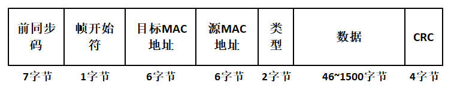

**arp报文格式：**

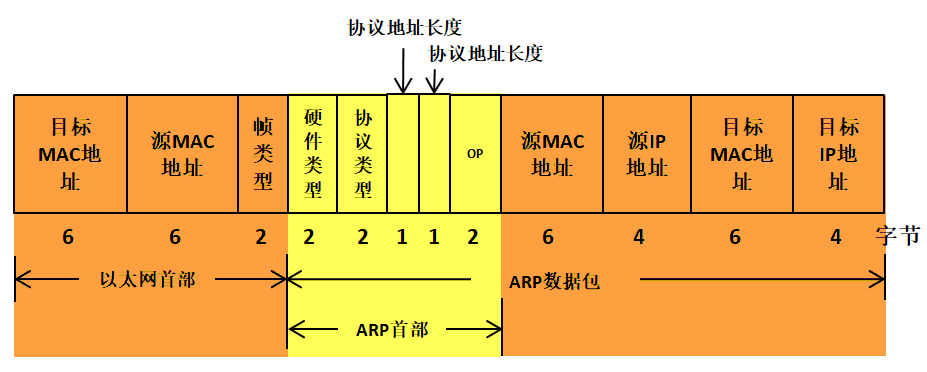

其他细节问题去看n32g455的源码吧，哦注意下n32g455本身没有mac层, 那是g45x的！反正能用的，因为我就是拿这个让AI给我参考zephyr的dm9051驱动支持好三个接口的。其他没有改动过东西！

支持以上后，结合最简单的初始化+测试：

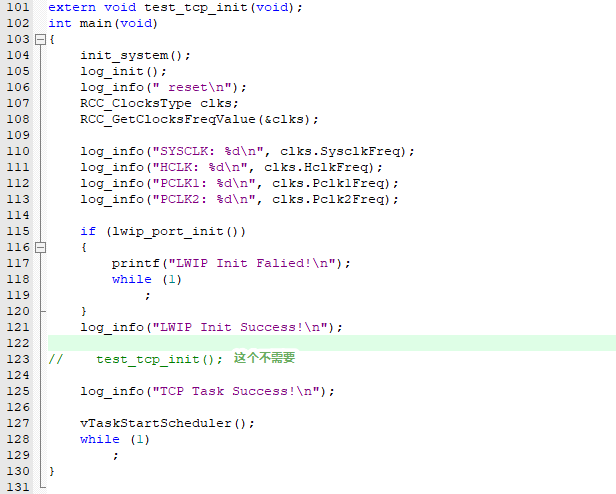

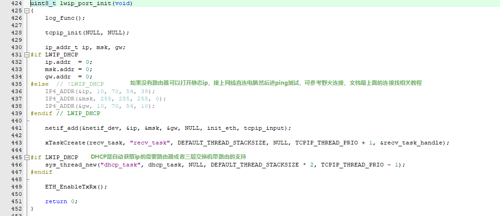

如果可以ping通开发板那你就是移植正常了，但稳定性需要看实际运行环境。
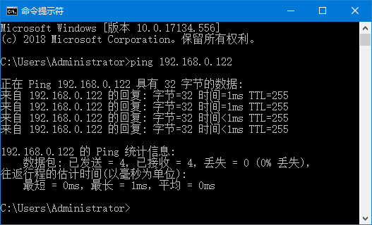

## 1.3、spi接口的DM9051(phy+mac)

```c
//1、我遇到一个只能dhcp后获取到分配ip的死活ping不通，后面从zephyr或者Linux的驱动文件，或者找淘宝供应商拿个代码工程，弄好了。
//2、pc ping 测试300次后dm9051没有响应后一直提升超时，抓逻辑分析仪发现最后一包数据的发送一帧以太网包数据时，突然来了一个int下降沿触发了exit中断, 然后进中断后读取了一次dm9051的数据插入了正在发送的以太网数据帧后就一直超时了，后面还是参考了淘宝供应商的需要在发送或者接收时禁止其他spi操作dm9051导致数据包插入其他数据导致包错的问题！ 加上锁就可以了。后面可以测试2小时7200多包稳定就没管了。
//可以参考下这老哥写的文章：https://blog.csdn.net/fanta/article/details/161579612?spm=1001.2014.3001.5506
//代码在lwip参考下有了，不用再跑到csdn或者淘宝供应商拿了。参考如下图比较关键的部分，反正侵权叫我删了就行了。我反正也是调着玩。
```

剩下的lwip的熟悉网络层后面再写了，主要参考：
[9. LwIP一探究竟 — [野火\]LwIP应用开发实战指南—基于野火STM32 文档](https://doc.embedfire.com/net/lwip/zh/latest/doc/chapter9/chapter9.html)
